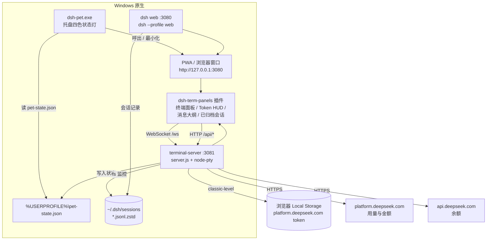

# DSH-Pet-Client-Win

**Windows 原生版 DeepSeek Harness pet 客户端** —— 托盘客户端 + 界面后端 + 终端/HUD 服务
完整一套，全部跑在 Windows 原生环境，**不依赖 WSL**。

姊妹项目：[`dsh-pet-client`](https://github.com/chongfengdy-dev/dsh-pet-client)（WSL / Linux 通用版）、
[`dsh-pet-client-kde`](https://github.com/chongfengdy-dev/dsh-pet-client-kde)（Linux 托盘状态灯）。

> **发布包已自带客户端 exe**：拿到 `DSH-Pet-Client-Win-*-share.zip` 的人
> **不需要编译任何东西** —— 解压 → 双击 `安装.bat` → 打开 <http://127.0.0.1:3080>。

---

## 一、项目来源

本项目从 [`dsh-pet-client`](https://github.com/chongfengdy-dev/dsh-pet-client) 独立而来：那套实现的后端
（dsh web 与 terminal-server）依赖 WSL 提供 bash、systemd 与 Python，Windows 侧只能算个壳。
2026-10-10 把后端整体原生化到 Windows，并把托盘客户端源码一并纳入本仓库，
形成一个**自包含**的 Windows 原生项目 —— 客户端与后端在这里是一个整体，不再分家。

后端原生化为四处等价替换（改写平台层，功能逻辑不变）：

| 原实现（WSL / Linux） | 本实现（Windows 原生） |
|---|---|
| systemd 托管服务（`dsh-web.service` / `dsh-terminal.service`） | PowerShell 服务层（`scripts\dsh-service.ps1`）+ 启动文件夹自启 |
| 终端跑 `$SHELL`（bash） | 终端跑 `powershell.exe`（真 PTY，可换 shell） |
| Python + `plyvel` 读浏览器 LevelDB 取平台 token | Node + `classic-level`（自带 win32-x64 预编译，读取结果与 plyvel **同指纹**） |
| Python 脚本聚合会话词元 | Node 内置 zstd（按魔数切多帧解压，**零 Python 依赖**） |

## 二、功能说明

| 功能 | 说明 |
|---|---|
| **托盘客户端** | `dsh-pet.exe`（Nim + winim，单文件、零 DLL）：托盘四色状态灯，左键呼出 / 最小化对话窗口 |
| **四色状态灯** | 蓝 = 窗口可见 ｜ 黑 = 收起 / 最小化 ｜ 橙闪 = 有提问或审批待处理 ｜ 绿闪 = 刚回复完；数据来自 `%USERPROFILE%\pet-state.json` |
| **对话界面** | 浏览器 / PWA 打开 `http://127.0.0.1:3080`（dsh web，profile: web） |
| **内嵌终端** | 页面右侧按钮开合，直连 3081 的 WebSocket；Windows 下开出的是 **PowerShell**（可用 `DSH_TERM_SHELL` 换成 `pwsh.exe` / `cmd.exe` 等） |
| **Token HUD** | 常驻右上角：输入(命中 / 未命中) / 命中率 / 输出 / **今日消耗金额** / 余额；余额与金额走 DeepSeek 官方接口 |
| **消息大纲** | 当前会话「我的消息」侧边导航（左缘横杠），hover 展开、点击跳转 |
| **已归档会话** | 侧栏面板：查看 / 打开 / 恢复 / 删除会话 |
| **纯净 / 完整模式** | `clean` 只留官方界面 + 认证同步（应急排查用），`full` 恢复全部插件 |
| **一键更新** | 页面提示有新版本时点更新：自动 `npm i -g`，并通过 `DSH_RESTART_CMD` 异步重启界面后端 |
| **开机自启** | 服务由启动文件夹的 `dsh-pet-client.vbs` 隐藏拉起；客户端由 `HKCU\...\Run` 的 `DSH-Nim-Client` 拉起 |

## 三、架构



**数据流**：插件在页面里渲染终端与 HUD → 通过 WebSocket / HTTP 连 3081 → 服务在本机跑
PowerShell PTY、聚合会话记录、代理平台用量接口 → 宠物状态写入文件，托盘客户端读取后变色。

**服务托管**：`scripts\dsh-service.ps1` 以后台隐藏窗口方式拉起两个 Node 进程，PID 记录在
`run\*.pid`，停止时用 `taskkill /T` 杀进程树，并在杀之前校验命令行包含部署根路径（防 PID 复用误杀）。

## 四、目录结构

```
DSH-Pet-Client-Win-v1.0/
├─ 安装.bat                  ★ 双击即装（等价于 scripts\install.ps1 -Start）
├─ client/                   托盘客户端
│  ├─ dsh-pet.exe    编译产物（发布包自带，免编译）
│  ├─ dsh-pet.nim    源码（仅依赖 winim 与标准库）
│  ├─ assets/                图标资源（编译期 staticRead 内嵌，11 个文件）
│  └─ icon.rc · icon.res     exe 外壳图标资源
├─ scripts/
│  ├─ install.ps1            部署：Node → dsh(缺失自动装) → 依赖 → 插件 → 客户端 → 自启
│  ├─ dsh-service.ps1        服务管理：start|stop|restart|status [web|term|all]
│  ├─ sync-plugins.ps1       把 plugins\ 同步进 profile（-Check 只体检，-Restart 同步后重启）
│  ├─ build-client.ps1       从源码编译客户端（动态定位 Nim / MinGW / winim）
│  ├─ pack-share.ps1         打包发布 zip（自带 exe + 敏感串扫描）
│  ├─ web-launch.ps1         dsh web 启动器（按标记决定是否走纯净模式）
│  ├─ restart-web.ps1        异步重启 web（一键更新调用，避免 30 秒超时）
│  └─ dsh-mode.ps1           纯净 / 完整模式：clean|full|status
├─ config/
│  └─ clean.patch.yml        纯净模式 patch（仅官方 base + web-app）
├─ plugins/                  本地插件实体副本（profile 内必须是真实目录副本，不能用符号链接）
│  ├─ dsh-term-panels/       终端面板 / Token HUD / 消息大纲 / 已归档会话
│  ├─ dsh-archive-sync/      归档集合变更即时同步
│  └─ dsh-web-token-sync/    把带 token 的认证链接写入 %USERPROFILE%\.dsh\dsh-web-token.txt
├─ terminal-server/          :3081 服务（Node，零 Python 依赖）
│  ├─ server.js
│  └─ lib/
│     ├─ platform-token.js   读浏览器 Local Storage 里的平台 token（classic-level）
│     ├─ today-usage.js      聚合本地会话记录统计当日词元
│     ├─ ask-pending.js      检测提问 / 审批待处理
│     └─ zstd-frames.js      dsh 会话文件的多帧 zstd 切分解压
├─ logs/ · run/              运行时日志与 PID（不入库）
├─ LICENSE                   MIT
├─ README.md                 本文档
└─ 使用说明.md                面向使用者的操作说明
```

## 五、部署

### 前置条件

- **Windows 10 / 11**
- **Node.js 22+**（词元统计用到内置 zstd）—— **唯一需要用户自备的东西**：
  没装的话 `install.ps1` 会检测到并给出下载地址

### 三步装好（推荐）

```
1. 解压   DSH-Pet-Client-Win-v1.0-share.zip
2. 双击   安装.bat
3. 打开   http://127.0.0.1:3080
```

`安装.bat` 会自动跑完 `scripts\install.ps1 -Start`，也就是：

| 步骤 | 做什么 |
|---|---|
| 1 | 检查 Node 版本 |
| 2 | 检查全局 dsh，**缺失则自动 `npm i -g @deepseek-ai/dsh`** |
| 3 | 安装 `terminal-server` 依赖（85 个包，约 17 秒，原生模块自带预编译） |
| 4 | 把 `plugins\` 下 3 个插件同步进 web profile |
| 5 | 部署托盘客户端到**桌面根目录**并注册其开机自启 |
| 6 | 注册服务开机自启（启动文件夹的 `dsh-pet-client.vbs`） |

**用户不需要编译任何东西**：客户端 exe 已随包分发。

### 分步 / 手动方式

```powershell
# 只部署、不启动
powershell -ExecutionPolicy Bypass -File scripts\install.ps1

# 部署后立即启动服务与客户端
powershell -ExecutionPolicy Bypass -File scripts\install.ps1 -Start

# 只装依赖与插件，不碰任何开机自启
powershell -ExecutionPolicy Bypass -File scripts\install.ps1 -NoAutostart
```

> 建议把 3080 装成 PWA（浏览器地址栏右侧「安装」图标）：独立窗口没有地址栏，
> 托盘状态灯也会优先跟随 PWA 窗口变色。
> dsh web 要求 token 认证时，带 token 的链接会自动写到
> `%USERPROFILE%\.dsh\dsh-web-token.txt`，直接打开文件里的链接即可。

### 日常管理

```powershell
scripts\dsh-service.ps1 status              # 两个服务的运行状态
scripts\dsh-service.ps1 restart             # web + term 都重启
scripts\dsh-service.ps1 restart term        # 只重启终端服务
scripts\dsh-mode.ps1 status                 # 当前模式
scripts\dsh-mode.ps1 clean                  # 切纯净模式（剥离第三方插件）
scripts\dsh-mode.ps1 full                   # 切回完整模式
scripts\sync-plugins.ps1                    # 改完 plugins\ 源码后同步进 profile
scripts\sync-plugins.ps1 -Check             # 只体检插件是否滞后，不改动文件
```

## 六、构建与编译

### 后端：无需编译

服务层是纯 Node / PowerShell，解压即可用：

- `terminal-server` 依赖通过 `npm ci` / `npm install` 安装（实测全新安装 **85 个包、约 17 秒**）；
- 涉及原生模块的两个依赖都**自带 win32-x64 预编译**，**不需要 VS Build Tools**：
  `node-pty`（终端 PTY）与 `classic-level`（读浏览器 LevelDB）；
- 前端部分由 dsh web 在启动时自行编译 bundle（首次启动较慢，属正常现象）。

### 客户端：通常不需要编译

发布包里已带 `client\dsh-pet.exe`。只有改源码或想自己出包时才需要：

```powershell
powershell -ExecutionPolicy Bypass -File scripts\build-client.ps1          # 编译
powershell -ExecutionPolicy Bypass -File scripts\build-client.ps1 -Run     # 编译并启动
```

脚本自动定位工具链（支持 PATH 或常见安装位置），不写死任何用户路径：

| 依赖 | 要求 | 查找方式 |
|---|---|---|
| **Nim** | 2.x | `nim.exe` 在 PATH，或 `<用户目录>\nim-*` |
| **MinGW-w64** | 提供 `gcc.exe` | PATH，或 `C:\mingw64` / `C:\msys64\mingw64` / `<用户目录>\mingw64` |
| **winim** | 3.9+ | `nimble install winim`（装到 `<用户目录>\.nimble\pkgs2\winim-*`） |

编译采用 MinGW 静态链接，产物是**单个 exe、零 DLL 依赖**；托盘图标与 exe 图标都已内嵌。
实测：**176,662 行 / 约 17 秒 / 587.7 KB**。

> 链接阶段可能出现 `ld.exe: .rsrc merge failure: multiple non-default manifests`，
> 这是资源段清单合并的提示，**不影响产物**。

### 打发布包

```powershell
powershell -ExecutionPolicy Bypass -File scripts\pack-share.ps1                 # 出到桌面
powershell -ExecutionPolicy Bypass -File scripts\pack-share.ps1 -Version v1.1   # 指定版本号
```

打包规则：文件清单以 `git ls-files` 为准（`.gitignore` 里的私密文件天然排除），
再补上**客户端 exe**；打包前跑一遍敏感串扫描（`userToken` 实值、`/home/*`、`C:\Users\*`、
`sk-`、`ghp_`、`DESKTOP-*`），命中即中止、不产出 zip。

## 七、注意事项

- **端口**：3080（界面后端）、3081（终端 / HUD / 状态）。两者被占时服务会启动失败，
  日志见 `logs\web.err.log`、`logs\term.err.log`（常见 `EADDRINUSE`）。
- **受限环境下的诊断**：`Get-NetTCPConnection`、`Get-CimInstance` 在沙箱 / 受限令牌下可能
  静默返回空，导致 `dsh-service.ps1 status` 误报 `stopped`。查端口请用 `netstat -ano`。
- **新机器首次启动**：若本地还没有平台 token 缓存，HUD 金额会在启动后 5–8 秒内取不到
  （首次需从浏览器 LevelDB 抓取），随后自动恢复；token 落盘后不再出现。
- **插件必须同步进 profile**：profile 内要的是**真实目录副本**，不能用符号链接
  （ESM 按真实路径解析依赖，链接过去会 `failed to import`）。
  改完 `plugins\` 下的源码后跑 `scripts\sync-plugins.ps1`，必要时再 `restart web`。
- **重复安装是安全的**：`install.ps1` 会先结束正在运行的客户端再替换 exe，替换后自动拉起来；
  依赖与插件都已就绪时会跳过。

## 八、版本历史

| 版本 | 日期 | 说明 |
|---|---|---|
| **v1.0** | 2026-10-10 | 首个 Windows 原生版本。后端（dsh web 3080 + terminal-server 3081）完成原生化并接管标准端口，terminal-server 零 Python 依赖（classic-level 读 token、Node 多帧 zstd 统计词元）；PowerShell 服务层（`dsh-service.ps1`）替代 systemd；**托盘客户端源码与资源并入本仓库**，发布包自带编译好的 exe（`pack-share.ps1` 一键出包）；`安装.bat` + `install.ps1` 做到下载即用（缺 dsh 自动安装、插件自动同步、客户端自动部署并注册自启）；平台 token 缺失自愈（HUD 金额不再空）；一键更新改为异步重启。 |

## 九、许可证

[MIT](LICENSE) —— 与 `dsh-pet-client` 一致。
