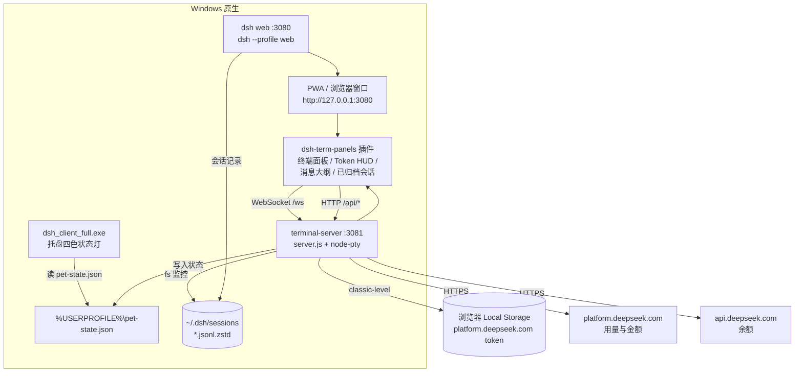

# DSH-Pet-Client-Win

**Windows 原生版 DeepSeek Harness pet 栈**：把界面后端与终端 / HUD 服务完全跑在 Windows
原生环境，**不依赖 WSL**。

姊妹项目：[`dsh-pet-client`](https://github.com/chongfengdy-dev/dsh-pet-client)（WSL / Linux 通用版）、
[`dsh-pet-client-kde`](https://github.com/chongfengdy-dev/dsh-pet-client-kde)（Linux 托盘状态灯）。

---

## 一、项目来源

本项目从 [`dsh-pet-client`](https://github.com/chongfengdy-dev/dsh-pet-client) 的 Windows 使用场景
中独立出来：那套实现的后端（dsh web 与 terminal-server）依赖 WSL 提供 bash、systemd 与 Python，
Windows 侧只能算个壳。2026-10-10 立项，把这两个服务原生化到 Windows，并保留与姊妹项目
**同一套插件、同一套 3080 / 3081 端口约定、同一份 `~/.dsh` 会话与记忆**，两边可随时对调或回退。

为此做了四件平台替换（都是等价改写，不是重写功能）：

| 原实现（WSL / Linux） | 本实现（Windows 原生） |
|---|---|
| systemd 托管服务（`dsh-web.service` / `dsh-terminal.service`） | PowerShell 服务层（`scripts\dsh-service.ps1`）+ 启动文件夹自启 |
| 终端跑 `$SHELL`（bash） | 终端跑 `powershell.exe`（真 PTY，可换 shell） |
| Python + `plyvel` 读浏览器 LevelDB 取平台 token | Node + `classic-level`（自带 win32-x64 预编译，读取结果与 plyvel **同指纹**） |
| Python 脚本聚合会话词元 | Node 内置 zstd（按魔数切多帧解压，**零 Python 依赖**） |

## 二、功能说明

| 功能 | 说明 |
|---|---|
| **对话界面** | 浏览器 / PWA 打开 `http://127.0.0.1:3080`（dsh web，profile: web） |
| **内嵌终端** | 页面右侧按钮开合，直连 3081 的 WebSocket；Windows 下开出的是 **PowerShell**（可用 `DSH_TERM_SHELL` 换成 `pwsh.exe` / `cmd.exe` 等） |
| **Token HUD** | 常驻右上角：输入(命中/未命中) / 命中率 / 输出 / **今日消耗金额** / 余额；余额与金额走 DeepSeek 官方接口 |
| **消息大纲** | 当前会话「我的消息」侧边导航（左缘横杠），hover 展开、点击跳转 |
| **已归档会话** | 侧栏面板：查看 / 打开 / 恢复 / 删除会话 |
| **宠物状态灯** | terminal-server 写 `%USERPROFILE%\pet-state.json`，托盘壳（`dsh_client_full.exe`）读取后变色：蓝=窗口可见 / 黑=收起 / 橙闪=有待处理提问 / 绿闪=回复完成 |
| **纯净 / 完整模式** | `clean` 只留官方界面 + 认证同步（应急排查用），`full` 恢复全部插件 |
| **一键更新** | 页面提示有新版本时点更新：自动 `npm i -g`，并通过 `DSH_RESTART_CMD` 异步重启界面后端 |
| **开机自启** | 启动文件夹里的 `dsh-pet-client.vbs` 隐藏窗口拉起 3080 + 3081 |

## 三、架构



**数据流**：插件在页面里渲染终端与 HUD → 通过 WebSocket / HTTP 连 3081 → 服务在本机跑
PowerShell PTY、聚合会话记录、代理平台用量接口 → 宠物状态写入文件供托盘壳读取。

**服务托管**：`scripts\dsh-service.ps1` 以后台隐藏窗口方式拉起两个 Node 进程，PID 记录在
`run\*.pid`，停止时用 `taskkill /T` 杀进程树，并在杀之前校验命令行包含部署根路径（防 PID 复用误杀）。

## 四、目录结构

```
dsh-pet-client-win/
├─ scripts/
│  ├─ install.ps1            部署：检查 Node/dsh → 装依赖 → 同步插件 → 注册开机自启
│  ├─ dsh-service.ps1        服务管理：start|stop|restart|status [web|term|all]
│  ├─ sync-plugins.ps1       把 plugins\ 同步进 profile（-Check 只体检，-Restart 同步后重启）
│  ├─ web-launch.ps1         dsh web 启动器（按标记决定是否走纯净模式）
│  ├─ restart-web.ps1        异步重启 web（一键更新调用，避免 30 秒超时）
│  ├─ dsh-mode.ps1           纯净 / 完整模式：clean|full|status
│  ├─ migrate-from-wsl.ps1   从 WSL 搬 profile / 插件 / 记忆（只读 WSL，覆盖前自动备份）
│  └─ switch-to-win.ps1      正式切换：停 WSL 服务 → Windows 接管 3080/3081，失败自动回滚
├─ config/
│  └─ clean.patch.yml        纯净模式 patch（仅官方 base + web-app）
├─ plugins/                  本地插件实体副本（profile 内必须是真实目录副本，不能用符号链接）
│  ├─ dsh-term-panels/       终端面板 / Token HUD / 消息大纲 / 已归档会话
│  ├─ dsh-archive-sync/      归档集合变更即时同步
│  └─ dsh-web-token-sync/    把带 token 的认证链接写入 %USERPROFILE%\.dsh\dsh-web-token.txt
├─ terminal-server/          :3081 服务（Node，零 Python 依赖）
│  ├─ server.js
│  └─ lib/
│     ├─ platform-token.js   读浏览器 Local Storage 里的平台 token（classic-level）
│     ├─ today-usage.js      聚合本地会话记录统计当日词元
│     ├─ ask-pending.js      检测提问 / 审批待处理
│     └─ zstd-frames.js      dsh 会话文件的多帧 zstd 切分解压
├─ logs/ · run/              运行时日志与 PID（不入库）
├─ LICENSE                   MIT
├─ README.md                 本文档
└─ 使用说明.md                面向使用者的操作说明
```

## 五、部署

### 前置条件

- **Windows 10 / 11**
- **Node.js 22+**（词元统计用到内置 zstd；`install.ps1` 会检查并提示）
- 全局 dsh：`npm i -g @deepseek-ai/dsh`

### 安装

```powershell
# 解压后在项目目录执行
powershell -ExecutionPolicy Bypass -File scripts\install.ps1 -Start
```

脚本依次做五件事：检查 Node → 检查全局 dsh → 安装 `terminal-server` 依赖 →
把 `plugins\` 同步进 web profile → 注册开机自启；`-Start` 表示装完立即启动。
加 `-NoAutostart` 可只装依赖、不动自启。

安装后打开 <http://127.0.0.1:3080>。

> 建议把 3080 装成 PWA（浏览器地址栏右侧「安装」图标）：独立窗口没有地址栏，
> 托盘状态灯也会优先跟随 PWA 窗口变色。
> dsh web 要求 token 认证时，带 token 的链接会自动写到
> `%USERPROFILE%\.dsh\dsh-web-token.txt`，直接打开文件里的链接即可。

### 日常管理

```powershell
scripts\dsh-service.ps1 status              # 两个服务的运行状态
scripts\dsh-service.ps1 restart             # web + term 都重启
scripts\dsh-service.ps1 restart term        # 只重启终端服务
scripts\dsh-mode.ps1 status                 # 当前模式
scripts\dsh-mode.ps1 clean                  # 切纯净模式（剥离第三方插件）
scripts\dsh-mode.ps1 full                   # 切回完整模式
scripts\sync-plugins.ps1                    # 改完 plugins\ 源码后同步进 profile
scripts\sync-plugins.ps1 -Check             # 只体检插件是否滞后，不改动文件
```

### 从 WSL 迁移 / 回退

```powershell
# 1) 先搬数据（只读 WSL；覆盖前备份到 .dsh\.migrate-backup-<时间戳>\）
powershell -ExecutionPolicy Bypass -File scripts\migrate-from-wsl.ps1

# 2) 确认 Windows 侧能独立跑起来后，再正式切换端口
powershell -ExecutionPolicy Bypass -File scripts\switch-to-win.ps1 -WaitSeconds 15

# 回退：把标准端口还给 WSL
powershell -ExecutionPolicy Bypass -File scripts\switch-to-win.ps1 -Rollback
```

切换会停掉 WSL 侧的 3080 / 3081 并让 Windows 接管，**当前页面会断一次**，请挑不忙的时候做。
迁移与切换都不会删除 WSL 侧数据。

## 六、构建与编译

**本项目没有编译步骤** —— 服务层是纯 Node / PowerShell，解压即可用：

- `terminal-server` 依赖通过 `npm ci` / `npm install` 安装（实测全新安装 **85 个包、约 17 秒**）；
- 涉及原生模块的两个依赖都**自带 win32-x64 预编译**，**不需要 VS Build Tools**：
  `node-pty`（终端 PTY）与 `classic-level`（读浏览器 LevelDB）；
- 前端部分由 dsh web 在启动时自行编译 bundle（首次启动较慢，属正常现象）。

**托盘壳 `dsh_client_full.exe`** 不在本仓库：它以 Nim + winim 编写，源码在姊妹项目
[`dsh-pet-client`](https://github.com/chongfengdy-dev/dsh-pet-client)（`dsh_client_full.nim`），
编译也在 Windows 侧进行（`build_and_install.bat`）。本项目直接复用该 exe —— 它只读
`%USERPROFILE%\pet-state.json`，与后端通过文件解耦，因此无需改动。

## 七、注意事项

- **端口**：3080（界面后端）、3081（终端 / HUD / 状态）。两者被占时服务会启动失败，
  日志见 `logs\web.err.log`、`logs\term.err.log`（常见 `EADDRINUSE`）。
- **受限环境下的诊断**：`Get-NetTCPConnection`、`Get-CimInstance` 在沙箱 / 受限令牌下可能
  静默返回空，导致 `dsh-service.ps1 status` 误报 `stopped`。查端口请用 `netstat -ano`。
- **新机器首次启动**：若本地还没有平台 token 缓存，HUD 金额会在启动后 5–8 秒内取不到
  （首次需从浏览器 LevelDB 抓取），随后自动恢复；token 落盘后不再出现。
- **`switch-to-win.ps1` 的前置条件**：它用 `pkill` 停 WSL 侧 terminal-server。若该服务由
  systemd 单元托管，会被 `Restart=` 策略拉回，导致 Windows 侧报 `EADDRINUSE`。
  执行前请先在 WSL 里 `systemctl --user stop dsh-terminal && systemctl --user disable dsh-terminal`。

## 八、版本历史

| 版本 | 日期 | 说明 |
|---|---|---|
| **v1.0** | 2026-10-10 | 首个 Windows 原生版本。dsh web(3080) 与 terminal-server(3081) 完成原生化并接管标准端口；terminal-server 零 Python 依赖（classic-level 读 token、Node 多帧 zstd 统计词元）；PowerShell 服务层（`dsh-service.ps1`）替代 systemd；插件随包发布并提供 `sync-plugins.ps1`；平台 token 缺失自愈（HUD 金额不再空）；一键更新改为异步重启。WSL 侧服务同步停用（数据保留）。 |

## 九、许可证

[MIT](LICENSE) —— 与 `dsh-pet-client` 一致。
